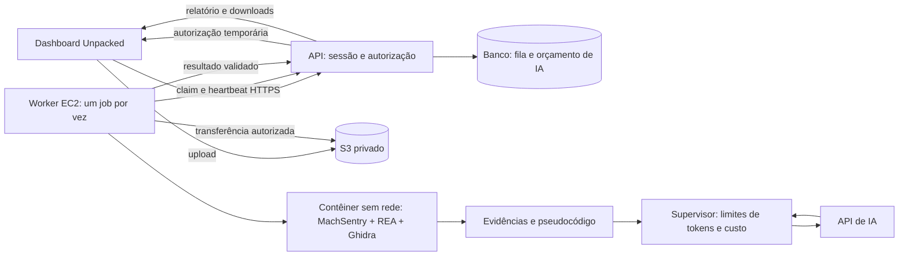

# Plano de integração MachSentry + Unpacked

Criado em 17/10/2026, atualizado em 18/10/2026. Estado: implementado e
implantado na AWS do Unpacked (ver a atualização abaixo); aceite pelo dashboard
pendente. Para continuar, começar pelo
[guia de continuidade do Unpacked](https://github.com/h4wk0x01/unpacked/blob/main/docs/ANALYSIS-CODEX-HANDOFF.md).

### Implementação — 18/10/2026

- Setup Linux x86_64 em `scripts/machsentry_setup.py`: JDK Temurin 21.0.12.1+1 e
  Node 24.18.0 Linux com SHA-256 oficiais no lock, decompilador `linux_x86_64` do
  zip do Ghidra 12.1.4, verificação de `procps`, CPython 3.12 e dependências
  Python por `scripts/machsentry-python-linux.lock.txt` com hashes.
- Worker em `worker/machsentry_worker/`: supervisor, contêiner de análise sem
  rede e sem credenciais, estágio de IA com reserva de orçamento no site, publicação
  com SHA-256 e watchdog. Protocolo em
  [ANALYSIS-SERVICE-CONTRACT.md](https://github.com/h4wk0x01/unpacked/blob/main/docs/ANALYSIS-SERVICE-CONTRACT.md).
- Automação em `deploy/worker/` (Dockerfile, bootstrap, systemd),
  `deploy/aws/worker.yaml` e `scripts/deploy_machsentry_aws.py`.
- Primeiro bootstrap na EC2 `t3a.medium` (us-east-2): 587 s; doctor saudável;
  verificador real em 105 s, 181 s de CPU e pico de 1,14 GiB da família de
  processos, no isolamento de um job. Imagem
  `sha256:d51bc5cdf171114817a52940c954e4b0a4f326e6f2132726fc167e433cae4eee`.
- As tabelas das seções 2, 7 e 11 abaixo registram o plano de 17/10; onde dizem
  "falta" ou "ainda não existem", valem as linhas acima.

### Atualização de escopo — 18/10/2026

O usuário decidiu começar por um piloto exclusivo de
`gabrielgpaiva@outlook.com`, integrado à `main` do Unpacked. Pro terá 7 créditos
de referência visual, **sem cobrança, consumo, renovação ou novos planos nesta
fase**. A implementação inicial deve priorizar autorização da conta, upload,
fila, REA/Ghidra, IA com teto operacional e resultado na tela. O livro de
créditos e as regras comerciais abaixo ficam para a abertura posterior a
assinantes. A IA continua no escopo; sua medição e limites de custo continuam
necessários mesmo sem cobrar créditos do administrador. O merge da interface
não implementa a API, o worker ou o instalador AWS.

A interface foi integrada e enviada à `main` do Unpacked no commit `fd4b017`.
Não houve deploy de produção. As propostas de cobrança da seção 6 e os campos
comerciais indicados nas demais seções são **futuros**, não tarefas do piloto.
Nenhuma decisão sobre vitalício/renovação precisa bloquear o piloto privado.

## 1. Resultado e decisões

O proprietário, e futuramente o assinante elegível, envia um Mach-O pela tela existente do Unpacked, acompanha a fila
e recebe um relatório padronizado com comportamentos, evidências, funções,
scripts, score e YARA. A IA interpreta as evidências e o pseudocódigo recuperados
pelo REA/Ghidra. O custo varia conforme o uso, com reserva prévia e teto por análise.

O usuário confirmou **IA desde a primeira versão, consumo variável e teto**.
No piloto, a reserva é de orçamento interno de IA; não há débito de créditos.
Os valores abaixo são propostas configuráveis para staging, não preços publicados:

| Item        | Proposta de MVP                                                             |
| ----------- | --------------------------------------------------------------------------- |
| Interface   | Reutilizar a interface já integrada na `main` do Unpacked                   |
| Motor       | MachSentry → MCP oficial do REA → Ghidra; somente análise estática          |
| IA          | Interpretação estruturada das evidências; no máximo uma correção de saída   |
| Hospedagem  | Servidor atual do Unpacked + uma EC2 Linux x86_64 dedicada ao worker        |
| Fila        | Banco existente do site; um trabalho em execução                            |
| Arquivos    | S3 privado, exclusão após processamento e rotina de limpeza                 |
| Créditos    | 7 de referência no Pro, sem cobrança; franquia comercial futura na seção 6  |
| Entrada     | Mach-O arm64/x86_64, thin ou universal, até 32 MiB                          |
| Fora do MVP | ZIP/DMG/PKG, execução de malware, chat livre, novos planos e recarga avulsa |

Não é necessário macOS na EC2 para interpretar Mach-O estaticamente. O provedor
Ghidra do REA contempla Linux; o instalador deste fork ainda precisa de suporte
Linux e verificação real. Não substituir o motor por um analisador independente.

## 2. Inventário verificado

Inspeção local atualizada: MachSentry `a263bf6bf`; Unpacked `fd4b017`, `main`,
incluindo a antiga branch `codex/macho-analysis-ui`. Localizar cada checkout
pelo remoto; caminhos do Unpacked abaixo são relativos à raiz desse projeto.
Nenhum estado de produção foi verificado nesta rodada.

| Código existente                                        | Estado observado e trabalho necessário                                                                                               |
| ------------------------------------------------------- | ------------------------------------------------------------------------------------------------------------------------------------ |
| Unpacked `components/analysis/analysis-panel.tsx`       | Tela pronta, usa `createDemoService()`; conectar dados reais mantendo o desenho                                                      |
| Unpacked `lib/analysis/http-service.ts`                 | Cliente `/api/analysis`; trocar multipart por upload privado, permitir retomada e ampliar polling além dos atuais 5 minutos          |
| Unpacked `lib/analysis/model.ts`                        | Contrato de protótipo; admitir score nulo, cobertura e evidências; reserva comercial fica para depois                                |
| Unpacked `lib/analysis/demo.ts`                         | Demo identificado: probabilidade 97 e execução “observada” são inventadas; 7 créditos de referência, uso zero; integrar fixture real |
| Unpacked `lib/analysis/file.ts` e `copy.ts`             | Limite de 50 MB; alinhar com 32 MiB e validação no servidor                                                                          |
| Unpacked `db/schema.ts`, `db/index.ts`                  | Drizzle/libsql, SQLite local por padrão; faltam análise/fila/orçamento IA; tabelas comerciais ficam para depois                      |
| Unpacked `lib/billing.ts`, `lib/stripe-webhook.ts`      | Preservar no piloto; elegibilidade/franquias e correção de atomicidade serão necessárias antes de integrar créditos comerciais       |
| Unpacked `scripts/deploy.sh`, `deploy/remote-deploy.sh` | Deploy próprio nginx/systemd; preservar e adicionar configuração do serviço separado                                                 |
| MachSentry `macos_static/machsentry/service.py`         | Relatórios REA/Ghidra; `runtime_llm_tokens = 0`; acrescentar interpretação por IA                                                    |
| MachSentry `scripts/machsentry_setup.py` e runtime lock | Windows/macOS; falta bootstrap Linux x64 com hashes e dependências nativas fixados                                                   |

Hoje não existem as rotas de análise, fila persistente, livro de créditos ou
worker comercial. As telas e o cliente HTTP não representam um serviço ativo.
O deploy do site contém premissas de host de 1 GiB/8 GB: isso é evidência do
código, não medição da máquina atual, e não será presumido suficiente para Ghidra.

## 3. Arquitetura mínima



O banco do site é o único dono da fila e dos orçamentos internos. O worker consulta uma
API restrita por HTTPS; não recebe o banco nem chaves Stripe. Fila SQL dispensa
Redis/SQS/Celery/Kubernetes neste MVP. A admissão do job é atômica e a reserva de
custo de IA é feita antes de cada chamada. Quando créditos comerciais forem
habilitados, sua reserva e criação do job deverão compartilhar uma transação.

O supervisor transfere arquivos e chama IA. REA/Ghidra roda em contêiner novo,
sem rede externa, credenciais ou dados do site. Loopback interno necessário ao
provedor permanece disponível. Depois de reter Evidence e confirmar fechamento
das sessões, o supervisor seleciona o material que será enviado à IA.

No MVP não há loop aberto de agente. A IA interpreta o código já recuperado;
uma segunda chamada pode corrigir saída inválida. Lacunas que exigem investigar
mais funções continuam explícitas. REA/Ghidra permanecem donos dos fatos.

## 4. Fluxo de upload e análise

1. Mostrar piloto sem cobrança e limites, selecionar arquivo e confirmar análise.
   Franquia, renovação e confirmação de teto em créditos ficam para a fase comercial.
2. `POST /api/analysis/uploads` exige sessão, conta proprietária, tamanho e
   limites por conta. Devolve ID e formulário S3 assinado por 5 minutos, com
   chave exata, MIME de transporte e `content-length-range` até 32 MiB.
3. Navegador envia ao S3 privado; o site não mantém o binário inteiro na RAM.
   Nome, extensão e MIME não comprovam formato. Sem upload público anônimo.
4. `POST /api/analysis/jobs` recebe upload ID, idioma e Idempotency-Key.
   O teto operacional vem da política do servidor.
   O servidor confere o objeto e sela cópia fora do prefixo gravável pelo usuário,
   condicionada à identidade observada para evitar corrida de sobrescrita.
   ETag não é SHA-256. O worker verifica tamanho/digest nos bytes recebidos.
5. Transação única valida propriedade/política/capacidade, consome upload
   e cria job `queued`. Repetição idêntica retorna o mesmo job; mesma chave com
   conteúdo diferente gera conflito. Cópia órfã por falha de transação é limpa.
6. Worker adquire posse, confirma identidade e passa o arquivo pela admissão
   REA. Executa o fluxo existente em diretório exclusivo, com prazo global.
7. Supervisor valida saída estática, prepara Evidence limitada por tokens,
   reserva custo da chamada de IA e valida schema/referências do resultado.
8. Publica artefatos privados e seus digests. A API registra resultado e concilia
   uso/custo interno sem repetir IA. Não há liquidação de créditos no piloto.
9. A tela lê o estado persistido. Reabrir, atualizar e baixar não cria nova
   análise nem nova chamada de IA. A amostra é excluída após a etapa estática;
   relatórios e dados derivados têm retenção separada.

Autorização S3 não é de uso único: pode sobrescrever/recriar o objeto até expirar.
Por isso existem cópia selada, hash conferido, limites de pendências e limpeza de
órfãos. [Upload S3](https://docs.aws.amazon.com/AmazonS3/latest/userguide/PresignedUrlUploadObject.html)
e [política POST](https://docs.aws.amazon.com/AmazonS3/latest/developerguide/sigv4-HTTPPOSTConstructPolicy.html).

## 5. IA com gasto limitado antes do envio

Candidato inicial para avaliar: Responses API com snapshot
`gpt-5.4-mini-2026-03-17`, saída estruturada, sem ferramentas externas e sem
troca automática por modelo mais caro. A qualidade ainda precisa de avaliação
com analista; escolha econômica não comprova qualidade de análise de malware.

Preços publicados consultados: US$ 0,75 por milhão de tokens de entrada,
US$ 0,075 de entrada em cache e US$ 4,50 de saída. Confirmar tarifa e acesso da
conta antes da ativação; processamento regional pode ter adicional.
[Modelo e preços](https://developers.openai.com/api/docs/models/gpt-5.4-mini).

| Parâmetro de staging | Proposta                                                  |
| -------------------- | --------------------------------------------------------- |
| Chamadas             | Até 2, incluindo correção, sem retries invisíveis do SDK  |
| Entrada total do job | 32.000 tokens somando pedidos, instruções e schemas       |
| Saída total do job   | 8.000 tokens incluindo raciocínio faturável               |
| Primeira chamada     | Até 24.000 de entrada / 6.000 de saída                    |
| Correção eventual    | Apenas saldo restante, até 8.000 / 2.000                  |
| Teto de IA           | US$ 0,075/job; também respeitar saldo do orçamento global |
| Teto global inicial  | US$ 2/dia e US$ 20/mês, configuráveis                     |

Ao preço citado, 32.000 de entrada sem cache e 8.000 de saída custam US$ 0,060.
É cálculo de teto de tokens, não média medida. Não depender de desconto de cache
para admitir um pedido; aplicar o desconto efetivo ao liquidar.

Antes de cada chamada, contar o pedido completo com contador/tokenizer compatível
e margem conservadora de framing; reservar atomicamente seu pior custo de
entrada/saída nos limites do job, dia e mês. Não enviar se qualquer orçamento
for insuficiente. Limitar `max_output_tokens`, que inclui raciocínio; resposta
incompleta não vira relatório concluído.
[Referência da API](https://developers.openai.com/api/reference/python/resources/responses/methods/create).

Registrar intenção, modelo/snapshot, versão de preço/prompt, request ID, uso de
entrada/cache/saída e custo de cada tentativa. Não somar raciocínio duas vezes
quando já faz parte da saída. Em perda de conexão após envio, marcar
`usage_unknown`, manter reservado o pior custo interno e não repetir
automaticamente uma chamada que pode ter sido faturada. Timeout e alerta do
provedor sozinhos não limitam gasto. A conciliação pode liberar orçamento interno
somente com desfecho conhecido; uso desconhecido nunca é contabilizado como zero.

A IA recebe identidade, cobertura, achados e pseudocódigo selecionado, não o
binário inteiro. Devolve resumo e inferências com `evidence_ids`. Validar que
IDs, VAs e arquiteturas existem e correspondem; isso valida referência, não
garante correção semântica de toda inferência. Testar com revisão de analista.
Strings e scripts são dados não confiáveis, nunca instruções. Não disponibilizar
shell, navegação, escrita ou acesso a IOC à IA.

Hash, score, funções, regra e validação YARA continuam provenientes do motor.
A IA não pode inventar execução, promover regra rejeitada, apagar limitações ou
chamar pseudocódigo de fonte original. Gerar interpretação no idioma do job;
troca de tela/idioma não dispara nova chamada paga.

Usar `store: false` e chave de projeto dedicada fora do contêiner. Informar ao
usuário que trechos recuperados vão ao provedor. Essa opção não garante retenção
zero em todos os mecanismos do provedor; verificar controles de dados antes de
prometer exclusão. [Política de dados](https://developers.openai.com/api/docs/guides/your-data).

## 6. Créditos e renovação — fase comercial futura

**Não implementar esta seção no piloto privado.** Manter apenas os 7 créditos
de referência da interface; medir e limitar custos de IA conforme seção 5.
Estas propostas preservam o planejamento anterior para uma decisão posterior.

Valores comerciais propostos para `lib/config.ts`, revisáveis antes da produção:

| Parâmetro                 | Proposta                                                               |
| ------------------------- | ---------------------------------------------------------------------- |
| Franquia                  | 7 créditos/mês                                                         |
| Base por análise entregue | 0,50 crédito                                                           |
| Parcela variável          | 1 crédito por US$ 0,05 de custo de IA                                  |
| Teto por job              | 2 créditos, limitado pelo saldo disponível                             |
| Precisão                  | Inteiros: 1 crédito = 1.000 unidades                                   |
| Renovação                 | Dia 1, 00:00 UTC; mostrar data no fuso do cliente                      |
| Validade                  | Sem acumular; cada franquia tem período próprio                        |
| Elegibilidade             | Pro mensal/anual e Pro PIX anual, com pagamento confirmado             |
| Vitalício                 | Inclusão da franquia recorrente pendente; não conceder automaticamente |

Fórmula, custo em micros de dólar e cobrança em unidades de crédito:

```text
cobranca = 500 + ceil(custo_IA_micros * 1000 / 50000)
teto_IA_micros = min(75000, floor((reserva - 500) * 50000 / 1000))
```

Exemplo: 20.000 tokens de entrada + 4.000 de saída, sem cache, custam US$ 0,033.
O relatório custa **1,16 crédito**: 0,50 base + 0,66 de IA. Reservados 2, devolver
0,84. Sete créditos não significam sete análises; a interface deve aceitar frações
e mostrar teto e consumo efetivo. Se saldo < 2, só admitir com teto menor quando
comportar uma interpretação útil; calibrar esse mínimo nos testes de qualidade.
Não reduzir silenciosamente a investigação nem deixar saldo negativo.

Reserva pertence à franquia original. Job que atravessa o mês liquida nela;
devolução expirada não aumenta a nova. Conceder a franquia atual com chave única
`(user_id, credit_program, month_utc)`, mediante elegibilidade, na consulta/admissão
e na conciliação. Não depender de cron exatamente à meia-noite. Pro anual recebe
mensalmente, sem antecipar o ano; assinaturas sobrepostas não duplicam franquia.
Para assinantes atuais, conceder o mês corrente uma vez, sem recompor meses antigos.

Separar validade paga da tolerância do acesso a conteúdo. Checkout provisório e
graça não geram créditos. Guardar período pago confirmado como fato de cobrança;
cancelamento ao fim do período mantém elegibilidade até essa data. Hoje
`processStripeEvent` registra evento antes das mutações de negócio: corrigir
atomicidade ou tornar processamento pendente recuperável antes de integrar
créditos. Falha após deduplicação não pode perder concessão no retry.

| Desfecho                                                                                  | Tratamento proposto                                                                       |
| ----------------------------------------------------------------------------------------- | ----------------------------------------------------------------------------------------- |
| Estático + IA válidos, todas as slices solicitadas processadas e cleanup confirmado       | Cobrar base + IA efetiva, até o teto                                                      |
| Funções não examinadas pelo limite documentado                                            | Resultado limitado pode ser cobrado; cobertura permanece explícita                        |
| Slice/provedor falhou, cleanup não confirmado, IA inválida/recusada ou orçamento esgotado | Liberar reserva; entregar dados parciais identificados; custo interno continua registrado |
| Cancelado ainda na fila                                                                   | Liberar reserva, sem processamento                                                        |
| Histórico/refresh/download                                                                | Sem cobrança ou nova IA                                                                   |

No MVP, cancelamento garantido somente na fila. Após início, fechar a tela
apenas deixa de acompanhar; resultado fica no histórico. Interrupção
administrativa por limites/falhas permanece possível. Limitar tentativas
repetidas por conta/amostra; falhas subsidiadas entram no orçamento global.
Estorno é lançamento compensatório com referência única, nunca apagar histórico.

Créditos não garantem margem. Nessa conversão, 7 créditos limitam IA faturável
a até US$ 0,35/mês por conta, antes da parcela base. Falhas são despesa separada
limitada. Somar EC2, armazenamento, impostos, pagamentos e suporte para validar
rentabilidade; nenhum custo médio/volume de produção foi medido.

## 7. Dados e APIs

Migrações aditivas no Unpacked; transações curtas, constraints e atualizações
condicionais no banco, não somente verificações prévias em JavaScript:

As entidades `analysis_credit_bucket` e `analysis_credit_entry` são futuras.
No piloto, implementar as demais responsabilidades sem ledger comercial.

| Entidade proposta        | Responsabilidade/invariantes                                                                                               |
| ------------------------ | -------------------------------------------------------------------------------------------------------------------------- |
| `analysis_upload`        | Dono, objeto temporário/selado, bytes, digest declarado/verificado, expiração e consumo único                              |
| `analysis_job`           | Dono, upload, chave idempotente + fingerprint, versões, idioma, estado/fase, tentativa, lease/token, deadlines e resultado |
| `analysis_worker`        | Identidade, versão, heartbeat, slot exclusivo e recuperação                                                                |
| `analysis_credit_bucket` | Concessão, período e expiração; unicidade por conta/programa/mês                                                           |
| `analysis_credit_entry`  | Grant/reserve/settle/release/refund/expire, unidades inteiras e referência única; razão imutável                           |
| `analysis_ai_call`       | Job/tentativa, estado, teto, preço/modelo, usage, request ID e custo; sem segredos                                         |
| `analysis_budget_period` | Custo realizado/reservado por dia/mês, reserva atômica                                                                     |
| `analysis_result`        | Versões, hashes, objetos privados, retenção e validação                                                                    |

Reutilizar o prefixo `/api/analysis` já previsto pelo cliente; não criar outra
API paralela. Atualizar contrato/clientes e servidor juntos:

| Rota proposta                      | Resultado                                                                                |
| ---------------------------------- | ---------------------------------------------------------------------------------------- |
| `GET /quota`                       | Política do piloto e referência sem cobrança; saldo/renovação reais só na fase comercial |
| `POST /uploads`                    | Nome/tamanho/digest declarado → ID e autorização temporária                              |
| `POST /jobs`                       | Upload ID, idioma, Idempotency-Key → 202 e job ID; teto definido no servidor             |
| `GET /jobs/:id`                    | Estado persistido, fase, datas, custo e resultado disponível                             |
| `POST /jobs/:id/cancel`            | Cancela `queued`; conflito se execução já começou                                        |
| `GET /reports`                     | Histórico paginado sem todos os relatórios completos                                     |
| `GET /reports/:id`                 | Resultado versionado do proprietário                                                     |
| `GET /reports/:id/artifacts/:kind` | Artefato permitido autenticado, sem caminho arbitrário                                   |

Cada operação verifica propriedade; IDs opacos não bastam. Proteção de origem/CSRF,
rate limits e erros estruturados. Sem credenciais/URLs assinadas/caminhos internos
em logs ou respostas. Evidências originais continuam preservadas: não redigir
hashes, strings ou IOC apenas por parecerem sensíveis.

Worker API em `/api/internal/analysis`: claim, heartbeat, reserva/liquidação de
chamada IA, complete e fail. Credencial aleatória por worker, escopo restrito,
hash no site, segredo no SSM e rotação. Toda mutação exige tentativa e token
de posse válidos. Transferências por autorizações de objeto limitadas ao job.
O site é o único dono dos orçamentos internos; o navegador não dita custo.
O mesmo princípio se aplicará a créditos comerciais quando forem habilitados.

## 8. Fila e recuperação

Estados: `queued`, `running`, `finalizing`, `completed`, `partial`, `failed`,
`cancelled`, `expired`. Fases: `static_analysis`, `ai_review`, `publishing`,
`cleanup`. Resultado e cobrança têm estados separados. Mostrar fase, sem
percentual fictício. O cliente deve recuperar job por ID após refresh.

Parâmetros iniciais para medir em staging:

- Um slot global, um job não terminal por conta e fila de até 20.
- Um upload pendente por conta, limites por conta/IP; rejeitar fila cheia antes
  de autorizar novos uploads. Pausar admissões sem worker saudável.
- Prazo global de 15 minutos para a etapa estática, 3 para IA e 2 para
  finalização: 20 minutos por tentativa. O timeout atual por chamada MCP não basta.
- 3 GiB para toda a família de processos, 2 vCPUs, 256 PIDs e 4 GiB de disco por
  job. Heap JVM não representa toda a memória. Perfil inicial: 64 funções/slice.
- Heartbeat 15 s, lease 90 s, polling com recuo e retomada. Uma repetição somente
  para falha transitória de infraestrutura; não repetir OOM/entrada inválida nem
  chamada de IA com faturamento desconhecido.

Lease/fencing impede publicação e cobrança por worker antigo, mas não mata seu
processo. Não reatribuir o slot antes de confirmar término do contêiner anterior.
O prazo local vale mesmo sem rede. No boot, reconciliar recursos por identidade;
em troca de host, parar/fencear EC2 anterior antes de liberar a substituta.
Não usar apenas PID como prova de propriedade.

Publicar artefatos antes de liquidar. Se a API falhar após publicação, repetir
só a conclusão, com os mesmos digests, não análise/IA. Se confirmação se perder
depois do commit, devolver estado já concluído. Cleanup não confirmado bloqueia
slot e alerta; manter responsabilidade pela limpeza até resolver.

## 9. Resultado na tela existente

Preservar `report-view.json` v1.0 e `report.json` v2.1 originais. Criar envelope
de serviço versionado com `static_report`, `ai_assessment`, estado e
referências de artefatos. Interpretação por IA possui schema próprio, versões
de modelo/prompt e referências Evidence. Adapter TypeScript transforma
apresentação, não reinterpreta bytes, strings, assembly ou regras.
Medição interna de custo permanece separada de cobrança comercial futura.

| Área existente        | Origem/ajuste                                                                              |
| --------------------- | ------------------------------------------------------------------------------------------ |
| Identidade            | `sample.name`, `sha256`, `size_bytes`, `architectures`; sem inventar hashes adicionais     |
| Score                 | `assessment.score`, inclusive `null`; “score heurístico”, nunca probabilidade calibrada    |
| Resumo/comportamentos | Fatos estáticos + interpretação de IA identificada, com evidências                         |
| Funções               | VA e arquitetura, nomes e comportamentos; pseudocódigo recuperado em detalhe opcional      |
| MITRE ATT&CK          | Só mapeamento explícito/verificável; indisponível no contrato atual, não copiar do demo    |
| Persistência          | Indícios com evidências; ausência de achado não comprova ausência de persistência          |
| Scripts               | Texto com origem/posição; nunca executar ou interpretar como HTML                          |
| IOCs                  | Indicadores recuperados, copiáveis; não abrir endpoints automaticamente                    |
| YARA                  | Regra, critérios, wildcard/origem, corpus e limitações; rejeitada sem download de detecção |
| Cobertura             | Estado por slice, funções omitidas, falhas e limitações sempre presentes                   |
| Créditos              | Piloto: 7 de referência, sem cobrança; saldo/renovação comerciais somente depois           |

Manter cards, cores e navegação existentes. As oito seções do HTML permanecem
fixas; IA enriquece interpretação sem modificar fatos. HTML/JSON para download
representam o mesmo resultado publicado, sem IA na exportação. Evidência
técnica fica em artefatos separados autenticados.

Primeiro entregável visual: carregar o resultado retido de
`reports/macos/html-report-v1/mcp-report/preview/report-view.json` na tela dessa
interface na `main`, com selo “fixture inerte / teste de integração”. Esse arquivo é ignorado
no Git; criar fixture segura e mínima de apresentação para os testes. Não chamar
isso de malware real nem inventar uma chamada de IA. Validar PT/EN e desktop/mobile.
O acesso exclusivo e a referência de créditos já foram alterados; a integração
de um resultado REA/Ghidra real na tela ainda não foi implementada.

## 10. Retenção e isolamento

| Dado                                   | Política proposta                                                                  |
| -------------------------------------- | ---------------------------------------------------------------------------------- |
| Upload abandonado                      | Excluir em até 1 hora pela rotina operacional                                      |
| Amostra na fila                        | Expirar em 24 h desde upload, liberar reserva e excluir                            |
| Amostra e cópias analisadas            | Excluir após etapa estática e cleanup, inclusive falhas                            |
| Projeto temporário Ghidra              | Exclusivo por job; reter Evidence, encerrar e remover; reconciliar no boot         |
| Relatório/scripts/evidências derivadas | 30 dias privados; informar que retêm dados extraídos                               |
| Logs                                   | 7 dias, sem binários, corpos de prompt, scripts ou credenciais                     |
| Livro de créditos                      | Retenção administrativa separada, sem amostra; prazo a definir antes do lançamento |

S3 bloqueia acesso público, usa TLS e criptografia. Bucket de amostras sem
versionamento/replicação/backups que retenham cópias ocultas. Exclusão explícita,
sweeper a cada 5 minutos e no boot, lifecycle de 1 dia como defesa adicional.
Lifecycle é assíncrono e delete marker não elimina versões antigas. Registrar
atrasos, repetir falhas e alertar; não prometer prazo físico absoluto em incidente.
[Expiração S3](https://docs.aws.amazon.com/AmazonS3/latest/userguide/lifecycle-expire-general-considerations.html).

Acesso expira na aplicação mesmo se limpeza atrasar. Sem cache entre contas.
Amostras nunca em `public/`, Git, imagem Docker ou snapshots do host. Usar área
de trabalho criptografada efêmera sem snapshots automáticos. Exclusão de arquivo
não comprova apagamento físico de todos os blocos do provedor.

Contêiner sem privilégios: usuário dedicado, base read-only, capabilities
removidas, no-new-privileges, filtro de syscalls, rede isolada, sem socket Docker,
IMDS ou credenciais; somente entrada read-only e saída exclusiva do job.
Supervisor fica fora dele. Containers compartilham kernel: host dedicado, sem
dados/chaves do site, atualizado e submetido a testes de isolamento antes da beta.

## 11. AWS e instalação automatizada

Proposta: Ubuntu LTS x86_64, `t3a.medium` (2 vCPU/4 GiB), 30 GB gp3 criptografado.
Escolher região conforme site e requisitos dos dados; us-east-1 é só referência
de preço. Validar disponibilidade e dimensionar com medições reais antes de fixar.
Usar CPU credits **Standard** explicitamente: evita excedente Unlimited, mas
reduz desempenho quando créditos de CPU acabam; monitorar fila/CPUCreditBalance.

Instância sem portas de entrada, administrada por SSM, saída HTTPS para site,
AWS e IA. IPv4 público para saída dispensa NAT Gateway neste desenho; entrada
permanece bloqueada. Contêiner de análise sem saída de rede.
[T3a](https://aws.amazon.com/ec2/instance-types/t3/) e
[Session Manager](https://docs.aws.amazon.com/systems-manager/latest/userguide/session-manager.html).

Estimativa ilustrativa para 730 horas/mês, sem descontos ou impostos:

| Item                       | Cálculo                                                   |
| -------------------------- | --------------------------------------------------------- |
| t3a.medium Linux us-east-1 | US$ 0,0376/h → US$ 27,45/mês                              |
| Um IPv4 público            | US$ 0,005/h → US$ 3,65/mês                                |
| 30 GB gp3                  | US$ 2,40/mês se tarifa regional = US$ 0,08/GB-mês         |
| Base                       | US$ 33,50 + S3, requisições, logs, registry, tráfego e IA |

EBS usa hipótese de tarifa do exemplo oficial, a confirmar por região. Não
inclui servidor atual do site e não promete capacidade por esse preço. Alertas
AWS não são limite síncrono de gasto.
[IPv4](https://aws.amazon.com/vpc/pricing/) e [EBS](https://aws.amazon.com/ebs/pricing/).

Entregáveis de automação a implementar:

| Repositório / arquivo proposto                  | Responsabilidade                                                                 |
| ----------------------------------------------- | -------------------------------------------------------------------------------- |
| MachSentry `scripts/machsentry_setup.py` + lock | Linux x64, hashes fixos, `procps`, build e doctor real; preservar setup upstream |
| MachSentry `deploy/worker/Dockerfile`           | Imagem REA/Ghidra/Python/JDK/Node/YARA testada, sem amostra/chave                |
| MachSentry `deploy/aws/worker.yaml`             | CloudFormation: EC2, EBS, rede/roles mínimos, S3, SSM, logs limitados            |
| MachSentry `scripts/deploy_machsentry_aws.py`   | Preflight, change set, deploy explícito, smoke test e configuração de saída      |
| MachSentry `deploy/worker/bootstrap.sh`         | Host dedicado/systemd, imagem por digest, readiness e recuperação                |
| MachSentry supervisor                           | Claim, limites, REA, IA, resultados e limpeza                                    |
| Unpacked migrações + `lib/analysis/server/`     | Autoridade de fila/API/storage e orçamento interno de IA                         |
| Unpacked deploy existente                       | Backup/migração, registro de worker, configuração e feature flag                 |

Experiência operacional pretendida: informar uma vez conta/região AWS, URL e
identidade do servidor web, credencial de registro do worker e chave de IA em
SSM SecureString; executar um comando. O script cria infraestrutura, instala,
testa fixture inerte e confirma site/Ghidra/storage/worker antes de dizer “pronto”.
Imagem construída no CI; não compilar ferramentas a cada job na EC2 pequena.
Fixar AMI/digest por release. Segredos nunca em Git, UserData, argumentos ou outputs.

Readiness com `CreationPolicy` e sinal de sucesso; falha de instalação não pode
ser deploy saudável. Acesso S3 do site por instance role se hospedado em EC2;
confirmar ambiente real e configurar identidade adequada antes de habilitar.
[CloudFormation](https://docs.aws.amazon.com/AWSCloudFormation/latest/TemplateReference/aws-attribute-creationpolicy.html).

Automação deve oferecer plan/deploy/status/logs/drain/rollback. Atualização drena
trabalho antes de trocar imagem; rollback conserva saldos/resultados e não desfaz
migração destrutivamente. Desinstalação não apaga banco/relatórios por padrão.
**Esses scripts ainda não existem: este plano especifica sua implementação.**

## 12. Sequência e aceite

| Etapa            | Entrega verificável                                                                  |
| ---------------- | ------------------------------------------------------------------------------------ |
| 1. Dados na tela | Adapter da fixture retida, score/cobertura corretos, preview PT/EN desktop/mobile    |
| 2. Linux         | Setup/imagem e fluxo real MCP/Ghidra, thin/FAT, cleanup e recursos medidos           |
| 3. IA            | Evidence selecionada, schema, orçamento, usage, referências e interpretação revisada |
| 4. Serviço       | Migrações, orçamento IA, API, upload privado, fila, worker, histórico e downloads    |
| 5. AWS           | Script/template, SSM, readiness, limpeza, métricas e rollback                        |
| 6. Piloto        | Fluxo real no dashboard com custos conciliados, somente proprietário; sem cobrança   |

Critérios de integração; cenários comerciais ficam para antes da abertura a
assinantes, sem bloquear o piloto privado:

- Linux real: arm64/x86_64/FAT, entrada inválida, timeout/OOM, hash imutável,
  encerramento de processos e cobertura honesta. Sem substituir o REA.
- Concorrência: duas submissões, limite de fila/slot, idempotência e reserva
  atômica do orçamento IA. Futuros: saldo comercial insuficiente, renovação
  duplicada e virada do mês com reserva de créditos em andamento.
- Recuperação: publicação com resposta perdida, finalização duplicada, lease
  vencido, reboot, disco cheio e restauração sem repetir cobrança/IA.
- IA: cache, raciocínio, truncamento, JSON inválido, recusa, 429 e timeout após
  envio; nunca disparar chamada fora do orçamento nem tratar usage desconhecido como zero.
- Fidelidade: prompt injection em strings, VA inventada, falsa execução,
  referência incorreta e limitações omitidas; avaliação por analista.
- Autorização: conta A não lê/baixa/cancela/sobrescreve B; URLs expiradas,
  objeto substituído, XSS e SSRF; nenhum artefato ou log público.
- Limpeza: sucesso/falha/abandono/expiração; sem binários em backup/imagem/log.
- UI: PT/EN/mobile/desktop, refresh na fila, worker offline, orçamento esgotado,
  IA falha, resultado parcial, score nulo e YARA rejeitada.
- YARA: compilação e testes no corpus informado, sem promessa universal de
  ausência de falsos positivos. IA não altera o estado de validação.

Medir tarefas completas representativas, frias/quentes: tempo, CPU, pico de RAM
da família de processos, disco, artefatos, tokens e dólares, incluindo falhas e
correções. A fixture inerte anterior não estima malware real ou capacidade AWS.
Mocks verificam contrato; usage de API real verifica custos; runtime Linux real
verifica implantação. Nenhuma dessas validações novas foi executada neste plano.

## 13. Pendências e próximo passo

IA no piloto está decidida. Implementar com parâmetros propostos em staging e
manter o serviço real desabilitado até verificar runtime, tetos, retenção do
provedor, região e orçamento. Isso não impede adapter, API/fila, isolamento e
testes locais. Não implementar ledger, renovação ou alterar Stripe nesta fase.
Ativação exige acesso AWS, identidade do servidor, chave de API faturável e
credencial de integração, sem compartilhar segredos em Git.

A interface restrita ao proprietário foi integrada à `main`, mas não houve
provisionamento, deploy do site ou chamada de IA de análise. Próxima entrega:
**resultado da fixture inerte na tela existente**, seguida de Linux, serviço
e IA limitada. O guia de continuidade vinculado no início organiza a execução
no outro computador e deve ser atualizado após cada marco verificado. O plano
não confirma que o servidor já esteja pronto para receber uploads.

## 2026-10-22: general function review (0.5.0)

The REA inventory now remains eligible after entry points and prioritized API,
indicator and call-graph references. The Unpacked worker grants up to 128
inspection attempts per architecture, 20 minutes static, 9 minutes AI and 2 minutes
publication. The AI stage also enforces its own duration when static analysis
finishes early.

Prompt unpacked-analysis-ai-v5 partitions full captured pseudocode, reviews
bounded batches and independently synthesizes exact source citations. It
preserves version 4 for existing grants. Review coverage counts validated
responses, hashes complete UTF8 sources and retains provider limitations and
facet availability. A semantic classification accompanies the original
heuristic score. Incomplete review stays explicit.

Limits: 12 calls, 40k conservative input tokens/call, 6k first output, 16k output/job,
US$ 0.10/job, US$ 0.75/account/month, US$ 5/day and US$ 40/month globally. Free jobs
remain bounded by their shared quota. See Unpacked docs/ANALYSIS-CODE-REVIEW.md.

Local evidence: 73 static tests and 212 worker tests pass (one platform skip in
each suite). An inert 40-function fixture improved from 16 to 40 decompiled functions;
28.142 to 32.275 seconds, one Windows measurement per version. Paid model regression
and AWS acceptance are recorded separately after execution. The opt-in
scripts/verify-machsentry-semantic-ai.py uses six inert code-text cases, a
persistent evaluation ledger and a US$ 0.10 cap. Run only with admissions drained
and the current global spending snapshot. It evaluates model interpretation,
not binary extraction or population accuracy.

Paid API regression accepted all six inert routines and the independently
validated synthesis: three calls, 7,198 input tokens, 4,669 output tokens,
US$ 0.026410. Five development rounds cost US$ 0.114602 in total, entered in
the service's shared ledger. The actual site adapter also accepted the source
citations from that run.

AWS bootstrap installed commit fb1fa337c3640114c2743b08b0d882266a04cd8a,
image sha256:0159c8bcd0e757c9810ea2c8cd01629f6594b2e695995242c8e6e0adcf46bfa6.
The native REA/Ghidra fixture verification passed in 105.105 seconds, with
180.333 CPU seconds and 1,218,899,968 peak resident bytes. Bootstrap took
543 seconds; CPU credits returned to standard and maintenance was removed.
The old image remains available for rollback. The Unpacked handoff records
the separate upload/queue/AI/publication acceptance and current admission state.

The first 24-function service acceptance retained every reviewed function, but
the synthesis repeated function notes and reached its output ceiling. Version 5
now keeps those notes solely in the verified ledger, constrains the final legacy
functions array to empty and reserves up to 6k tokens for the synthesis within
the same 16k/job and US$ 0.10 ceilings. Contract tests cover 24 notes, absence of
duplicate annotations and the final output reservation.

Correction ea35a26039fe84f2c3daaf0c23498d5b89077493 was installed by SSM command
53db82a3-6c62-4f89-9c75-91de96904030. That installation used image:
sha256:f1bc5461fd21d1761028ea483f3ffaf7c51ceb1ea6fdfcbc1b23c1eaa5a4a4e4.
The native verification passed in 113.291 seconds, with 193.932 CPU seconds
and 1,260,630,016 peak resident bytes. Bootstrap took 634 seconds and ended
with the instance stopped, standard CPU credits and no maintenance tag.
Drain admissions and wait for the managed run to close and the EC2 to stop
before bootstrapping: the earlier command expired without starting during an
automatic shutdown. The deployment status command recovered that attempt.

A second service acceptance reviewed 24/24 functions for US$ 0.046020, then
the site rejected the worst-case 6k synthesis reservation. Version 5 now tries
smaller output reservations (4k, then 2k) at the same call index after a
job_budget denial. Rejected reservations send no provider request. A received
or uncertain model response is never repeated, and global budget denials stop
immediately. Tests verify the distinction and unchanged paid-call counts.
The opt-in evaluation can replay an explicitly identified retained inert Ghidra
report, preserving native pseudocode and provider context without another upload
or another student credit. Operator costs still enter the shared service ledger.

Synthesis citations can select a new exact quote from code supplied to that
request. The quote must also belong to a previously reviewed chunk; architecture,
full-source digest and original Unicode offsets remain verified. Invented quotes
and code omitted from the synthesis context are rejected. Validated responses
with unresolved coverage/context retain an inconclusive verdict and their gaps,
instead of reporting an unfinished AI stage. Negative verdicts still require full
inventory review, routine per-function verdicts and resolved gaps. Routine
constant-return helpers are identified in the prompt as code whose caller can
be unnecessary for interpreting its implemented effects.

The retained native-code replay passed on d61c09e24668c60c4e30a079f89a0684d4e33a5c:
24/24 functions, complete inventory review, three validated source quotations and
a no_malicious_behavior_observed synthesis. Seven paid calls used 25,549 input
and 7,383 output tokens, US$ 0.052387, in 46.428 seconds. The actual Unpacked
adapter accepted the same assessment. The input was an operator-created inert
universal Mach-O, extracted previously by production REA/Ghidra. This replay
used retained code and no student credit; the two earlier service jobs and
their partial results remain unchanged. Both paid replay rounds were entered
in the shared service budget. Detailed receipts and the final deployed image
are recorded in Unpacked's ANALYSIS-CODEX-HANDOFF.md.

Final AWS installation of d61c09e24668c60c4e30a079f89a0684d4e33a5c passed:
SSM 8aa19524-1ce5-4c80-b1f0-c1fa420b142b, active image
sha256:48827ebbcad0799072609b776b057b7ae8983ab3816b6563ce0664fcda36d8f7.
Bootstrap took 1,029 seconds; real REA/Ghidra verification took 116.485 seconds,
199.089 CPU seconds and 1,237,880,832 peak resident bytes. The prior image is
retained for rollback. Admissions reopened, instance stopped, CPU credits
standard, worker mode active and maintenance tag removed. Operator installation
time is recorded in the site's worker-hour ceiling. At 14:13 UTC the shared
ledger recorded US$ 0.393440 AI/month, zero unknown calls and 7,940 worker seconds.
